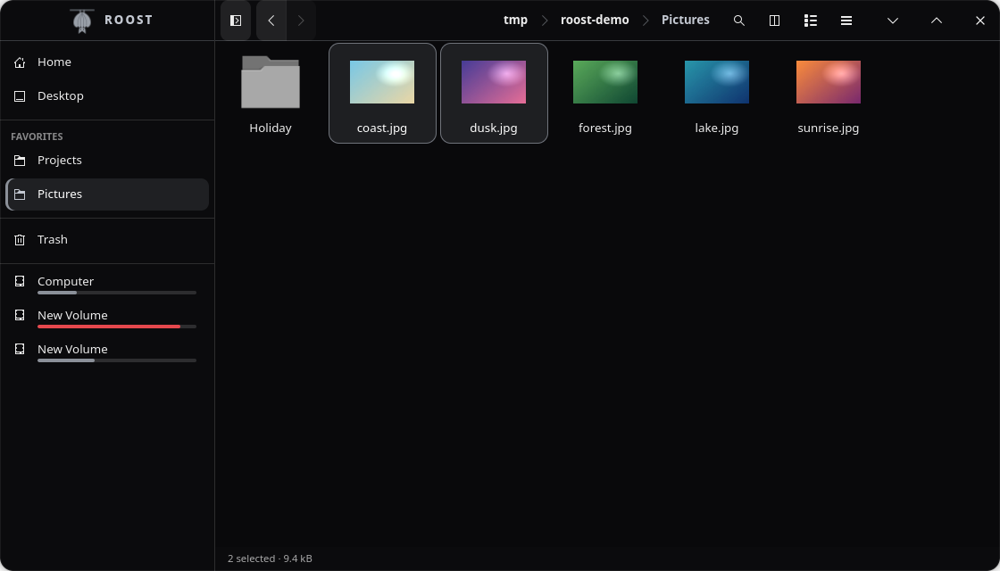
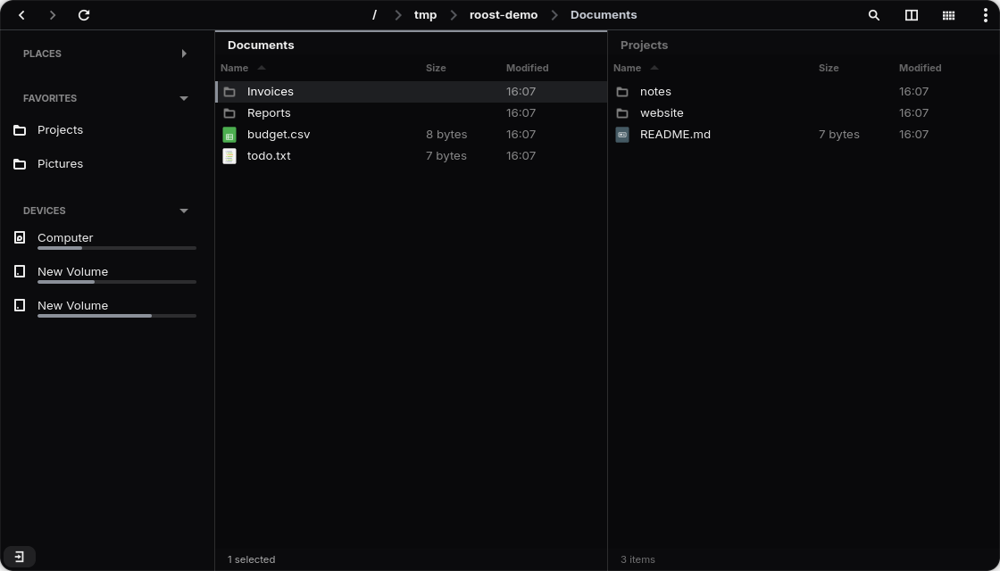
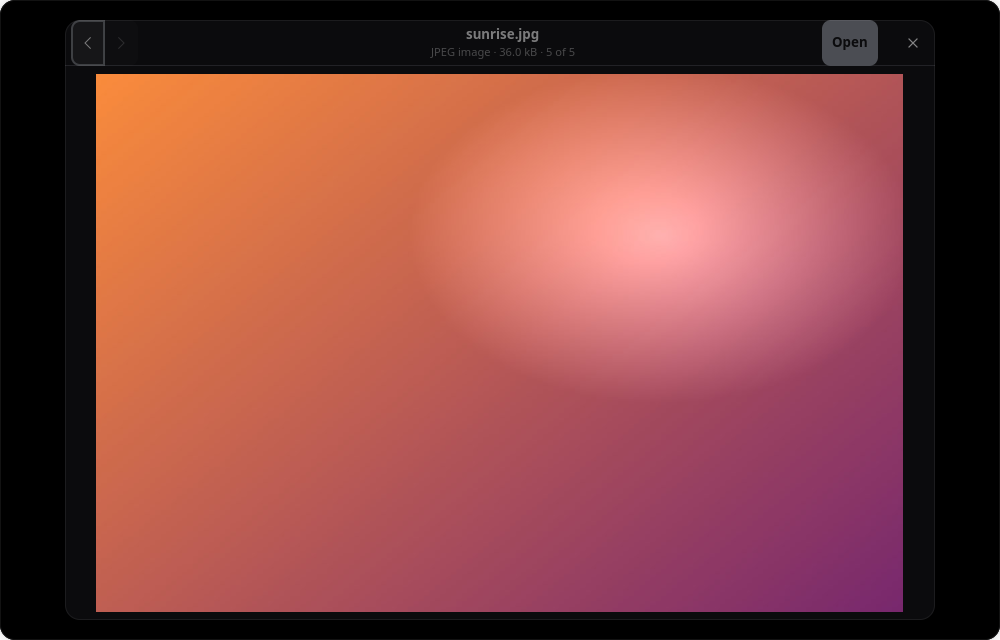
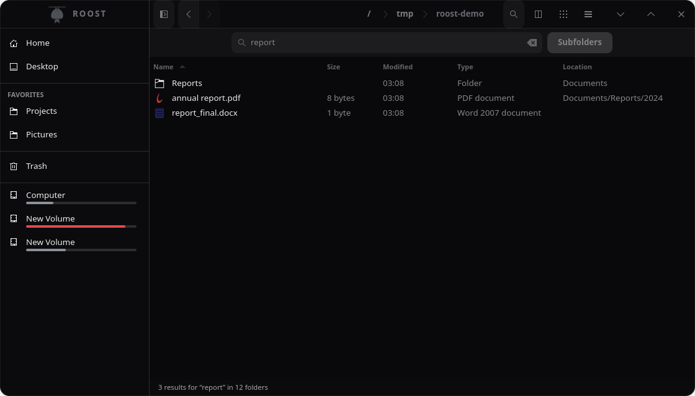

<p align="center">
  
</p>

<h1 align="center">Roost Xplorer</h1>

<p align="center">
  A sleek, dark file manager for Linux, built with GTK 4 and libadwaita.<br>
  Tabs, side-by-side split view, search inside subfolders, favorites, undo, and live progress for file operations.
</p>

<p align="center">
  
</p>

Roost Xplorer is a file manager written in Python. It follows your GNOME/libadwaita look but uses its own dark gray theme, and it has a handful of things many file managers lack: **real undo**, **a progress bar that follows what has actually been written to the drive**, and **search that looks through every subfolder**.

> **Status:** early release (0.1). It is used daily on Fedora KDE Plasma (Wayland). It works, but expect rough edges, and please report what you find.

## Features

**Browsing**
- Grid view with image thumbnails, and a list view with sortable columns. The list hides columns that don't fit, so file names stay readable in narrow panes.
- **Zoom** the grid icons with <kbd>Ctrl</kbd>+scroll or <kbd>Ctrl</kbd>+<kbd>+</kbd> / <kbd>Ctrl</kbd>+<kbd>-</kbd> (<kbd>Ctrl</kbd>+<kbd>0</kbd> resets).
- **Quick preview** (<kbd>Space</kbd>): a large preview of an image, PDF or text file. Use <kbd>←</kbd> / <kbd>→</kbd> to step through the folder, <kbd>Page Up</kbd> / <kbd>Page Down</kbd> for PDF pages, <kbd>Enter</kbd> to open the file, <kbd>Space</kbd> or <kbd>Esc</kbd> to close.
- Tabs you can **drag out into their own window** (or right-click a tab: *Move to New Window*, *Duplicate Tab*, *Close Other Tabs*), a breadcrumb path bar (click it, or press <kbd>Ctrl</kbd>+<kbd>L</kbd>, to type a path), back/forward history, and a sidebar you can resize or hide.
- **Split view** (<kbd>F3</kbd>): two folders side by side. Drag files between them, or send the selection across with <kbd>F5</kbd> (copy) and <kbd>F6</kbd> (move).
- Remembers your view, sort order, window size and open tabs (including split panes) between launches.

<p align="center">
  
</p>

<p align="center">
  
</p>

**Search**
- Type to search the current folder **and everything below it**. Results stream in as they are found, nearest folders first.
- Several words must all match (`final report`), and wildcards work (`*.pdf`). Results show which subfolder they live in, and *Show in Folder* jumps straight to the file.
- The **Subfolders** button switches to simply filtering the current folder.

<p align="center">
  
</p>

**Safe file operations**
- A progress indicator with bytes done, speed and time left. You can cancel at any point; nothing half-copied is left behind.
- **Undo** (<kbd>Ctrl</kbd>+<kbd>Z</kbd>, or the *Undo* button on the message that follows each operation) for copy, move, delete, rename and new folder.
- When a name already exists you choose **Keep Both**, **Skip**, **Replace** or (for folders) **Merge**, with an *Apply to all* option. *Replace* moves the old item to the Trash first, so nothing is lost and Undo brings it back.
- Drag and drop everywhere: onto folders, into the other pane, or onto sidebar entries. Hold <kbd>Ctrl</kbd> to copy instead of move.

**Sidebar**
- Places, **Favorites**, Trash and your disks. Add a favorite by right-clicking a folder, pressing <kbd>Ctrl</kbd>+<kbd>D</kbd>, or dragging a folder onto the *Favorites* heading, and **drag favorites up and down** to put them in your order.
- Disks show a **usage bar** that turns red when they are nearly full. Hover for the exact free space.
- USB sticks, SD cards and network shares get an **eject button** right in the sidebar.
- Give any disk or favorite a friendlier **label** with a right-click. This only changes the name shown in the sidebar, never the disk itself.
- Mount and unmount disks from the right-click menu (the system asks for your password when it needs to).

**Files and archives**
- **Compress** the selection to `zip`, `tar.gz` or `tar.xz` (with progress and cancel), and **Extract Here** for zip and tar archives. With the 7-Zip tool installed it also opens `7z`, `rar` and more. Extraction skips anything that tries to write outside the folder, and an archive with a single top-level folder isn't wrapped in another one.
- **New File** (next to New Folder) and **Copy Path** (copies the full path of the selection, or of the current folder).

**Everyday touches**
- **Translucent Blur** (main menu): a see-through window with a frosted-glass blur behind it, so your wallpaper shows through softly. The blur needs a desktop that supports it (KDE Plasma 6 does); elsewhere you still get the translucent look, just without the blur. Turn it off for a solid window. Popups and dialogs always stay solid so text stays readable.
- Soft hover and selection fades, a short crossfade when switching views, and progress bars that glide.
- Right-click menus with Open With, Open in Terminal, Properties (folder sizes included) and more.
- Trash with **Restore** (to the original location) and **Empty Trash**.
- Backspace, <kbd>Alt</kbd>+<kbd>↑</kbd> or a double-click on empty space goes up a folder.

## Requirements

- Linux with a desktop session (Wayland or X11)
- Python 3.12 or newer (developed on 3.14)
- GTK **4.12** or newer and libadwaita **1.5** or newer, with PyGObject

That means Fedora 40+, Ubuntu 24.04+, Debian 13+, Arch, and openSUSE Tumbleweed or newer. Older releases (for example Debian 12 or Ubuntu 22.04) ship a Python or libadwaita that is too old.

## Install

**1. Install the dependencies** for your distribution:

| Distribution | Command |
|---|---|
| Fedora | `sudo dnf install python3-gobject gtk4 libadwaita` |
| Ubuntu / Debian | `sudo apt install python3-gi gir1.2-gtk-4.0 gir1.2-adw-1` |
| Arch / Manjaro | `sudo pacman -S python-gobject gtk4 libadwaita` |
| openSUSE | `sudo zypper install python3-gobject typelib-1_0-Gtk-4_0 typelib-1_0-Adw-1 libadwaita` |

**Optional extras:** `poppler-utils` (PDF previews) and `p7zip` / `7zip` (opening `7z` and `rar` archives). Everything else works without them.

SVG icons also need `librsvg` (it is already installed on nearly every desktop; on Ubuntu/Debian the package is `librsvg2-common`).

**2. Get Roost Xplorer and install it:**

```bash
git clone https://github.com/aditya-kumar-k/roost-xplorer.git
cd roost-xplorer
./install.sh
```

The installer needs no root access. It checks that GTK and libadwaita are recent enough (and tells you what to install if they aren't), then adds:

- a launcher command, `~/.local/bin/roost-xplorer`
- an entry in your app menu ("Roost Xplorer")
- the app icon

Everything stays inside your home folder. Roost Xplorer runs straight from the cloned folder, so **keep that folder where it is** after installing.

**3. Start it** from your app menu, or run:

```bash
roost-xplorer
```

If your shell says `command not found`, add `~/.local/bin` to your `PATH`. The app-menu entry works either way.

### Just try it, without installing

```bash
git clone https://github.com/aditya-kumar-k/roost-xplorer.git
cd roost-xplorer
python3 roost_xplorer.py            # opens your home folder
python3 roost_xplorer.py ~/Music    # or any folder
```

### Make it your default file manager (optional)

```bash
./install.sh --set-default
```

This makes Roost Xplorer the app that opens folders (for example when another app says "Show in folder"). To go back, set another app as the default, for instance:

```bash
xdg-mime default org.gnome.Nautilus.desktop inode/directory     # or org.kde.dolphin.desktop, thunar.desktop, ...
```

To open it with a keyboard shortcut such as <kbd>Super</kbd>+<kbd>E</kbd>, assign one to the *Roost Xplorer* entry in your desktop's keyboard-shortcut settings (on KDE Plasma: System Settings → Keyboard → Shortcuts).

### Update

```bash
cd roost-xplorer
git pull
```

No reinstall is needed, because the launcher points at this folder.

### Uninstall

```bash
./uninstall.sh            # removes the launcher, menu entry and icon
./uninstall.sh --purge    # ...and also deletes your saved settings
```

Then delete the cloned folder if you like.

## Keyboard shortcuts

| Action | Shortcut |
|---|---|
| New window | <kbd>Ctrl</kbd>+<kbd>N</kbd> (starting the app again, or <kbd>Meta</kbd>+<kbd>E</kbd>, also opens a new window) |
| New tab / close tab | <kbd>Ctrl</kbd>+<kbd>T</kbd> / <kbd>Ctrl</kbd>+<kbd>W</kbd> |
| Search (or just start typing) | <kbd>Ctrl</kbd>+<kbd>F</kbd> |
| Type a path | <kbd>Ctrl</kbd>+<kbd>L</kbd> |
| Back / forward | <kbd>Alt</kbd>+<kbd>←</kbd> / <kbd>Alt</kbd>+<kbd>→</kbd> |
| Up one folder | <kbd>Alt</kbd>+<kbd>↑</kbd> or <kbd>Backspace</kbd> |
| Home folder | <kbd>Alt</kbd>+<kbd>Home</kbd> |
| Open | <kbd>Ctrl</kbd>+<kbd>O</kbd> or <kbd>Enter</kbd> |
| Quick preview | <kbd>Space</kbd> |
| Right-click menu from the keyboard | <kbd>Menu</kbd> key, or <kbd>Shift</kbd>+<kbd>F10</kbd> |
| Cut / copy / paste | <kbd>Ctrl</kbd>+<kbd>X</kbd> / <kbd>C</kbd> / <kbd>V</kbd> |
| Rename | <kbd>F2</kbd> |
| Move to Trash | <kbd>Delete</kbd> |
| Delete permanently (asks first) | <kbd>Shift</kbd>+<kbd>Delete</kbd> |
| New folder / new file | <kbd>Ctrl</kbd>+<kbd>Shift</kbd>+<kbd>N</kbd> / <kbd>Ctrl</kbd>+<kbd>Alt</kbd>+<kbd>N</kbd> |
| Copy the path | <kbd>Ctrl</kbd>+<kbd>Shift</kbd>+<kbd>C</kbd> |
| Select all | <kbd>Ctrl</kbd>+<kbd>A</kbd> |
| Undo | <kbd>Ctrl</kbd>+<kbd>Z</kbd> |
| Add or remove the current folder as a favorite | <kbd>Ctrl</kbd>+<kbd>D</kbd> |
| Show hidden files | <kbd>Ctrl</kbd>+<kbd>H</kbd> |
| Grid view / list view | <kbd>Ctrl</kbd>+<kbd>1</kbd> / <kbd>Ctrl</kbd>+<kbd>2</kbd> |
| Bigger / smaller / normal icons | <kbd>Ctrl</kbd>+<kbd>+</kbd> / <kbd>Ctrl</kbd>+<kbd>-</kbd> / <kbd>Ctrl</kbd>+<kbd>0</kbd> (or <kbd>Ctrl</kbd>+scroll) |
| Show or hide the sidebar | <kbd>F9</kbd> |
| Split view on/off | <kbd>F3</kbd> |
| Switch between panes | <kbd>F4</kbd> |
| Copy / move selection to the other pane | <kbd>F5</kbd> / <kbd>F6</kbd> |

## Your settings

Roost Xplorer saves its settings to `~/.config/roost-xplorer.json`: your view and sort choices, window size, open tabs, favorites and disk labels. It contains folder paths from your own computer, so don't share it. Delete the file to start fresh, or run `./uninstall.sh --purge`.

If you used an earlier build of this app, your old settings are copied over automatically on first start.

## Troubleshooting

- **"Roost Xplorer needs Python 3.12 ... GTK 4.12 ... libadwaita 1.5"** – your system is too old or the packages are missing. See [Install](#install).
- **The icon is missing in the app menu** – log out and back in once, or run `gtk-update-icon-cache -f -t ~/.local/share/icons/hicolor`.
- **Mounting a disk shows "Not authorized"** – the system needs your password for internal disks. Make sure a polkit authentication agent is running (every full desktop session has one).
- **PDF previews say "install poppler"** – install the `poppler-utils` package.
- **Open in Terminal does nothing** – it uses the first terminal it finds (Konsole, Ptyxis, GNOME Terminal, Kitty, Alacritty, xterm, and a few others). Install one of them.

## Known limitations

- Search inside subfolders works for local folders (not network locations or the Trash) and stops after 5,000 results.
- Previews cover images, PDFs (first pages) and text; there is no audio or video playback. Archives you create are `zip`, `tar.gz` or `tar.xz`.
- Tested mainly on Fedora KDE Plasma under Wayland. Reports from other desktops and distributions are very welcome.

## Contributing

Bug reports and ideas are welcome in the [issue tracker](https://github.com/aditya-kumar-k/roost-xplorer/issues). When reporting a bug, please mention your distribution, desktop environment, and the output of running `python3 roost_xplorer.py` in a terminal.

The whole application is a single file, [`roost_xplorer.py`](roost_xplorer.py), so it is easy to read and change.

## License

[MIT](LICENSE) © 2026 Aditya Kumar K
